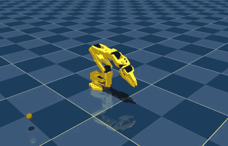

# SO-101 Robot Arm: Reinforcement Learning in MuJoCo, Deployed to Hardware

A 5-joint [SO-101](https://github.com/TheRobotStudio/SO-ARM100) robot arm learns to move its
gripper to any target point in front of it. The policy is trained with PPO in MuJoCo, evaluated
on held-out targets, and run on the physical arm through [LeRobot](https://github.com/huggingface/lerobot)
behind several layers of safety checks. A second, contact-rich task (pushing a block onto a
goal) is in progress.

<p align="center"></p>

## Results

| Task | Result (simulation) |
|---|---|
| Reach a random 3D target | **100% success** (tip within 2 cm) on 200 held-out targets; median final distance **0.12 cm** |
| Same, with randomized physics, sensor noise and control delay | 99.5% success (trained without randomization) |
| Training cost | 2M steps, about 17 minutes on CPU (8 parallel environments) |
| Push a block onto a goal | In progress (see [Push task](#push-task-in-progress)) |

The policy has also run on a physical SO-101 follower arm. Real-world accuracy hasn't been
measured yet.

### How success reached 100%

All three models below were scored on the **same** 200 held-out targets (front workspace,
spread evenly):

| Model | Training targets | Success | Median miss |
|---|---|---|---|
| Original | all around the arm, random joint angles | 90.0% | 0.46 cm |
| Scoped to the front | front only, random joint angles | 90.0% | 0.19 cm |
| **Even coverage** | front only, spread evenly over the reachable space | **100%** | **0.12 cm** |

Scoping to the front matched training to the real job but didn't by itself improve
accuracy. Even coverage of the workspace is what took success from 90% to 100%. Each row is
a single training run (one seed).

Earlier runs, each scored on its own training distribution:

| Change | Steps | Success |
|---|---|---|
| Original reward, default policy noise | 2.4M | 80% |
| Lower initial exploration noise + a precision reward term | 1.5M | 83% |
| Same with 16 environments instead of 8 | 3M | 81.5% (targets all around the arm) |

1. **Check the task is solvable first.** Early training learned slowly. A scripted inverse-kinematics
   controller using the same action interface reached 86%, which showed the problem was the
   learning setup, not the task. Starting with less random exploration (`log_std_init = -1`) and
   adding a reward term that rises sharply in the last few centimetres roughly halved the steps
   needed.
2. **More parallel environments isn't free.** With 16 environments each PPO iteration collects
   twice as much data, so over the same number of steps the policy is updated half as often.
   It learned more slowly per step (48% vs. 83% at 1.5M).
3. **Break failures down before training longer.** 27 of the 37 misses at 81.5% were targets
   behind the arm, which need it to flip over the top. The arm's real tasks are all in front,
   so the task was scoped to the front half.
4. **The training distribution is part of the model.** One remaining failure was reachable but
   lay where random *joint angles* almost never put a target (0 of 3,000 samples within 3 cm).
   `WorkspaceSampler` instead picks a 3 cm cell of the reachable space uniformly, then a point
   inside it. On the same test targets, that took success from 90% to 100%.

## Quick start (Windows, PowerShell)

Requires Python 3.10.

```powershell
python3.10 -m venv .venv
```
```powershell
.\.venv\Scripts\python.exe -m pip install -r requirements.txt
```
```powershell
.\.venv\Scripts\python.exe -m pytest
```

Train and evaluate the reach policy:
```powershell
.\.venv\Scripts\python.exe train.py --run-name reach --timesteps 2000000
```
```powershell
.\.venv\Scripts\python.exe evaluate.py --model runs\reach\best_model.zip --episodes 200
```
`evaluate.py` prints success rate and final distances and saves `runs\reach\rollouts.mp4`.
Training progress is in TensorBoard (`.\.venv\Scripts\tensorboard.exe --logdir runs`).
Every PPO and environment setting is a flag (`train.py --help`).

For the real arm, also install LeRobot with Feetech servo support:
```powershell
.\.venv\Scripts\python.exe -m pip install -r requirements-real.txt
```

`requirements.txt` pins direct dependencies; `requirements-lock.txt` is the full tested
environment. PyTorch is the CPU build on purpose: with a 256×256 network the bottleneck is
physics simulation, and moving tiny batches to a GPU is slower.

## Project layout

```
so101_rl/
  env.py          reach environment (Gymnasium); observation/action helpers shared with run_real.py
  push_env.py     push-a-block environment
  config.py       environment settings and domain randomization (off by default)
  kinematics.py   model loading, forward kinematics, damped-least-squares IK
  targets.py      reachable target sampling, including the even-coverage WorkspaceSampler
  mapping.py      MuJoCo radians <-> LeRobot joint values
  safety.py       joint clamping and per-step rate limiting for real commands
  tasks.py        task name -> config and environment class
train.py          PPO training (--task reach|push)
evaluate.py       success rate, distance statistics, rollout video
run_real.py       runs a trained reach policy on the physical arm (dry run by default)
assets/so101/     official SO-101 MuJoCo model and meshes, plus reach and push scenes
tests/            pytest suite (47 tests)
```

## Reach environment

| | |
|---|---|
| Control | 20 Hz (25 × 2 ms physics steps); 100-step (5 s) episodes |
| Action | 5 values in [-1, 1]: change in each joint's position target, at most 0.05 rad (2.9°) per step, clamped to joint limits minus 5°. The gripper is held closed. |
| Observation (24) | joint angles, joint velocities, tip position, target position, scaled tip-to-target vector, previous action |
| Reward | `-d + 0.5·[d < 2 cm] + (1 - tanh(d / 5 cm)) - 0.01·|a|²`, where d is the tip-to-target distance in metres |
| Targets | reachable by construction (forward kinematics of a valid, collision-free joint configuration), spread evenly over the reachable space, at least 5 cm above the table and within 90° of straight ahead |
| Tip | the model's `gripperframe` site, between the jaws |

Design choices:
- **Joint position changes, not torques.** The real servos are position-controlled, so the policy
  speaks the hardware's language, and small per-step changes are naturally smooth.
- **Observations come only from joint angles.** Tip position and velocity are computed from
  them, because the real arm reports positions only. Simulation and hardware share one
  `build_observation()` function.
- **Domain randomization hooks** (off by default; `--dr` turns on a preset): joint damping,
  armature and friction; servo strength (0.4–1.2×, which covers 7.4 V servos on a 5 V supply);
  joint-angle noise; and 0–2 steps of control delay.

## Push task (in progress)

`train.py --task push` trains the same arm, with the same actions, to push a 4 cm, 50 g cube
onto a goal disc. Episodes are 10 s, and success means the block ends within 3 cm of the goal.
This task is simulation only; `run_real.py` refuses push models.

| Reward design | Success after 1.5M steps | What the policy did |
|---|---|---|
| Reward for being near the block, plus distance to goal | 6% | touched the block and shoved it in random directions |
| Reward for reaching a point *behind* the block (away from the goal), plus per-step progress | 8% (16% at best checkpoint) | pushed the block further, but not yet consistently toward the goal |

The first design is a classic reward-shaping trap: touching the block earned reward on its
own, so the policy learned to touch rather than push. A longer run (30M steps) is the next
step.

## Running on the real arm

`run_real.py` drives a calibrated SO-101 follower through LeRobot 0.4.4. **By default it is a
dry run:** it connects, reads the arm, and prints every command it *would* send.

1. Read-only mapping check. Renders what the simulator thinks the arm's pose is
   (`mapping_check.png`) so it can be compared with the real arm. Nothing moves.
   ```powershell
   .\.venv\Scripts\python.exe run_real.py --check-mapping
   ```
2. Dry run of the policy:
   ```powershell
   .\.venv\Scripts\python.exe run_real.py --model runs\reach\best_model.zip
   ```
3. Live, one target first (asks you to type `YES`):
   ```powershell
   .\.venv\Scripts\python.exe run_real.py --model runs\reach\best_model.zip --live --targets 0
   ```

The arm moves slowly to a home pose, runs the policy toward each of five fixed safe targets
(returning home in between), then returns to its starting pose. `--fake` runs the whole
sequence against a simulated arm.

**Safety layers, every control step:**
- policy action clipped to its valid range
- joint targets clamped to the simulator's limits *and* the arm's calibrated range minus 3°
  (LeRobot doesn't clamp in degrees mode)
- at most 1.5° change per step (30°/s), with a hard cap of 3°
- LeRobot's own `max_relative_target` (5° from the measured position)
- targets only from a fixed list
- **Ctrl+C** stops the policy and slowly returns to the start pose; a second Ctrl+C holds the
  current pose

### Joint units and mapping

LeRobot 0.4.4 reports joints in degrees by default:
`deg = (raw - mid) · 360 / 4095`, where `mid` is the middle of the calibrated range.
The official MuJoCo model also puts each joint's zero at mid-range, so the mapping is
`q_mujoco = deg2rad(lerobot_deg)` with no sign flips or offsets. The evidence:
- the model's zero convention matches LeRobot's
- LeRobot's own SO-101 kinematics uses plain `deg2rad` with the same model
- the calibrated joint ranges match the model's
- recorded real poses all land inside the model's limits, and flipping a joint's sign puts
  them in the floor
- `pose_check.py` renders were checked by eye against the real arm

The tests check the mapping against LeRobot's actual normalize/unnormalize code in both unit
modes, including rounding to integer servo ticks. `--sign joint=-1` overrides a joint if a
rebuilt arm turns the other way.

Known sim-to-real differences: the simulated servos are full strength; the real arm runs at
about half the policy's training speed because of the 1.5° safety cap; and gear backlash and
calibration error aren't modelled.

## Other hardware scripts

Utilities written while bringing up the arm. All use LeRobot on `COM20` with calibration id
`my_follower`; change these for your setup.

| Script | What it does |
|---|---|
| `pose_check.py` | read-only, torque off: renders the simulator's view of the current pose |
| `keyboard_drive.py` | drive one joint at a time from the keyboard |
| `xyz_control.py` | move the gripper in x/y/z centimetres using the model's kinematics |
| `teach_replay.py` | pose the arm by hand at waypoints, then replay them smoothly |
| `record_motion.py` | record a hand-guided motion at 50 Hz and play it back (`motions/`) |
| `monitor.py`, `arm_guard.py` | live servo telemetry and bump detection |
| `bump_test.py`, `nudge_test.py` | measure tracking error and load; small motion test |

## Acknowledgements

The SO-101 MuJoCo model and meshes in `assets/so101/` are from
[TheRobotStudio/SO-ARM100](https://github.com/TheRobotStudio/SO-ARM100) (commit 141aea7),
Apache-2.0; see `assets/so101/LICENSE`. Training uses
[Stable-Baselines3](https://github.com/DLR-RM/stable-baselines3) and
[Gymnasium](https://github.com/Farama-Foundation/Gymnasium); hardware access uses
[LeRobot](https://github.com/huggingface/lerobot).
